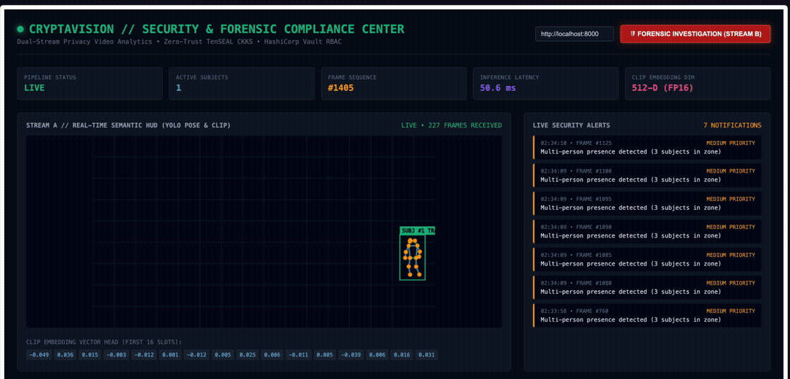
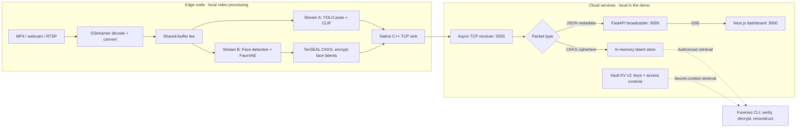

<div align="center">

# CryptaVision

### Video intelligence at the edge. Encrypted evidence in the cloud.

A privacy-focused surveillance prototype combining native video pipelines,<br>
neural inference, homomorphic encryption, and a live security dashboard.


[Demo](#demo) · [Architecture](#architecture) · [Quick start](#quick-start) · [Engineering decisions](#engineering-decisions) · [Validation](#validation) · [Roadmap](#roadmap)

</div>

---

## Overview

Security cameras capture more information than a monitoring dashboard needs. Sending entire video frames to a central server increases network traffic and places identifiable imagery inside the cloud's trust boundary.

**CryptaVision explores a different design: extract useful signals locally, then transmit semantics and encrypted facial representations through separate logical streams.** Operators monitor pose skeletons, subject counts, and scene embeddings; a separate forensic workflow is designed to recover authorized facial evidence from encrypted latents.

The project brings together systems programming, computer vision, cryptography, asynchronous APIs, and frontend visualization in one runnable development stack. The demonstrated path is **local video → edge inference → native TCP → FastAPI SSE → dashboard**. The forensic path remains under development; its prerequisites are documented in [Current scope](#current-scope).

## Demo

https://github.com/user-attachments/assets/0d75540a-ada2-4df6-89b5-d8c2f535bd0f

**[▶ Open the full dashboard recording](https://github.com/user-attachments/assets/0d75540a-ada2-4df6-89b5-d8c2f535bd0f)** &nbsp;·&nbsp; [Download the MP4](https://github.com/AtharvaRathi/CryptaVision-Zero-Knowledge-Neural-Video-Codec/raw/refs/heads/main/docs/assets/cryptavision-demo.mp4) &nbsp;·&nbsp; [View screenshot](docs/assets/dashboard.png)

The full recording is approximately **51 seconds**. The dashboard renders metadata; raw camera frames are not displayed in the Stream A canvas.

<details>
<summary><strong>View a lightweight animated preview</strong></summary>

[](https://github.com/user-attachments/assets/0d75540a-ada2-4df6-89b5-d8c2f535bd0f)

An eight-second excerpt from the full recording. Click the preview to open the full demo.

</details>

### What the dashboard shows

| Capability | Visible behavior |
| :--- | :--- |
| Pose visualization | Detected people appear as skeletons with derived bounding boxes |
| Subject counts | Active subject count updates with each semantic frame |
| Frame telemetry | Frame sequence, inference latency, and the CLIP embedding vector |
| Rule-based alerts | Multi-person presence and inference-latency notifications |
| Feed health | `WAITING FOR FRAMES`, `LIVE`, or `FEED STALLED`, based on arriving data |
| Forensic interface | A separate interface for requesting protected Stream B latents |

## Architecture



Solid arrows show the streaming path. Dashed arrows show the intended forensic workflow, which requires the key provisioning and model work described below.

### Two streams, one ingest connection

| | Stream A — monitoring | Stream B — forensics |
| :--- | :--- | :--- |
| Edge computation | YOLOv8 pose inference and CLIP scene embeddings | Face detection and 128-dimensional FaceVAE latent extraction |
| Payload | JSON: keypoints, counts, embeddings, timings | Face metadata envelope plus serialized CKKS ciphertext |
| Protection | Cleartext metadata in the current development transport | Latent values encrypted before transmission |
| Cloud consumer | SSE/WebSocket subscribers and dashboard | Protected retrieval API and forensic tooling |
| Local validation | Demonstrated with the sample video and live dashboard | Components implemented; reconstruction not validated end to end |

Both payload types share a framed TCP connection. The protocol uses a **9-byte header**: 4-byte `CRYP` magic (`0x43525950`), 4-byte payload length, and 1-byte type (`0x01` JSON or `0x02` CKKS). Integer header fields use network byte order. The receiver reads exact payload lengths before routing packets.

## Engineering decisions

| Decision | Why it matters |
| :--- | :--- |
| GStreamer `tee` with separate queues | Branches share input buffers while isolating inference workloads; frame mapping still copies data into NumPy for inference |
| Custom C++ TCP sink | Moves packet framing and socket transmission into a native GStreamer element |
| Metadata instead of full frames | Gives operators an abstract monitoring view while limiting raw imagery in the primary cloud path |
| CKKS through TenSEAL | Supports approximate numeric-vector encryption; this implementation encrypts latents but does not demonstrate cloud-side homomorphic analytics |
| Thread-to-async broadcaster | Bridges GStreamer callbacks to FastAPI consumers without blocking on each browser client |
| Bounded queues and frame skipping | Favors fresh telemetry under load instead of accumulating stale frames |
| Segment-based video looping | Repeats local input without rebuilding the pipeline or reconnecting TCP |
| Supervised process groups | One terminal owns Vault, API, dashboard, and edge processes, including Node descendants |
| Frame-driven feed status | Distinguishes a connected SSE socket from a feed actually delivering detections |

**Cryptographic configuration:** polynomial modulus degree `8192`, coefficient modulus bit sizes `[60, 40, 40, 60]`, scale `2^40`, and default latent dimension `128`. These are implementation parameters, not a claim of a security audit.

## Quick start

The documented local workflow targets **macOS on Apple Silicon with Python 3.11**. The edge runner uses standard software decoding and supports file, webcam, and RTSP sources. Other operating systems need their own native dependency setup.

### 1. Install native prerequisites

Have the following available before running setup:

- Python **3.11** — preferably `/opt/homebrew/bin/python3.11` on Apple Silicon.
- Node.js and npm, plus the HashiCorp Vault CLI.
- CMake, a C++17 compiler, and pkg-config.
- GStreamer with base/good/bad/libav plugins, GLib, and GObject introspection.
- ffmpeg and curl for downloading and converting the test clip.

The setup script installs Python packages and frontend dependencies; it does not install these system tools. See the [local setup guide](README-local.md) for platform notes and troubleshooting.

### 2. Clone, download the sample, and launch

```sh
git clone https://github.com/AtharvaRathi/CryptaVision-Zero-Knowledge-Neural-Video-Codec.git
cd CryptaVision-Zero-Knowledge-Neural-Video-Codec

./download_sample_video.sh
./start_cryptavision.sh --setup
```

`--setup` creates or uses the Python 3.11 virtual environment, installs all four requirements files and PyGObject, compiles the native plugins, runs `npm ci`, and starts the services. Initial AI-model loading may download weights.

The sample downloader tries the Wikimedia walking clip, then falls back to [OpenCV's pedestrian surveillance sample](https://github.com/opencv/opencv/blob/4.x/samples/data/vtest.avi). It creates a genuine H.264 MP4 named `test_surveillance_feed.mp4`. The fallback clip is 768×576; local video files loop automatically.

### 3. Open the dashboard

| Service | Local address | Purpose |
| :--- | :--- | :--- |
| Dashboard | <http://localhost:3000> | Skeletons, telemetry, and alerts |
| API documentation | <http://localhost:8000/docs> | Interactive endpoint reference |
| Health probe | <http://localhost:8000/health> | API and Vault diagnostics |
| TCP ingest | `127.0.0.1:5555` | Edge-to-cloud binary packets |
| Vault dev server | `127.0.0.1:8200` | Ephemeral key storage; cluster port `8201` |

For subsequent runs, start everything with one command:

```sh
./start_cryptavision.sh
```

Press **Ctrl+C once** in that terminal to stop the managed stack. The supervisor allows graceful cleanup, then kills remaining process groups if necessary.

<details>
<summary><strong>Other sources and useful launcher options</strong></summary>

```sh
# Live webcam remains available as an explicit option.
./start_cryptavision.sh --source webcam

# Another local clip or an RTSP camera.
./start_cryptavision.sh --source /path/to/video.mp4
./start_cryptavision.sh --source rtsp://camera/stream

# Synthetic input, environment checks, or a longer startup timeout.
./start_cryptavision.sh --source test
./start_cryptavision.sh --check
./start_cryptavision.sh --timeout 180
```

The launcher selects the project virtual environment, sets macOS library and GStreamer plugin paths, checks occupied ports, waits for Vault, enables its `cryptavision/` KV v2 mount, and verifies backend/TCP readiness before starting the edge runner. Logs carry service labels and terminal colors; `NO_COLOR=1` disables colors.

</details>

## API surface

| Endpoint | Purpose |
| :--- | :--- |
| `GET /health` | API, GPU availability, and Vault diagnostics |
| `GET /stream/status` | Backend pipeline state and broadcaster statistics |
| `GET /analytics/stream-a` | SSE events; frames use the `semantic_frame` event type |
| `WS /ws/analytics/stream-a` | WebSocket access to Stream A |
| `GET /analytics/stream-b` | Compliance-token-protected ciphertext retrieval |
| `POST /stream/start`, `POST /stream/stop` | Control the API-managed pipeline |

The launcher runs a **separate edge process**. Its frames can reach the dashboard while `/stream/status` reports the API-managed pipeline as `IDLE`. Avoid starting a second pipeline through the API when using the local launcher.

## Validation

The local demo has been checked through the actual native TCP sink and browser, including visible pedestrian skeletons, subject counts, CLIP embeddings, advancing frames, and alerts. Shutdown checks confirmed release of ports `3000`, `8000`, `5555`, `8200`, and `8201`.

A focused regression selection passed **20 tests** during local validation:

```sh
DYLD_FALLBACK_LIBRARY_PATH=/opt/homebrew/lib \
GST_PLUGIN_PATH="$PWD/plugins/build" \
venv/bin/python -m pytest \
  tests/test_start.py \
  tests/test_local_pipeline.py \
  tests/test_video_loop.py \
  tests/test_ai_engine.py::TestSemanticAnalyzer -q
```

This selection covers process cleanup, source resolution, video looping, real C++ TCP packet delivery, and semantic-output compatibility. It is not a claim that the full test suite, deployment workflow, or forensic reconstruction has passed. Inference latency varies by hardware and scene; no cross-platform benchmark is claimed.

## Current scope

CryptaVision is a **development prototype** with a working semantic monitoring demo and an unfinished forensic integration.

| Area | Current boundary / next step |
| :--- | :--- |
| Shared key provisioning | Edge and backend generate separate CKKS contexts; a matching context lifecycle is needed to decrypt edge-produced ciphertexts |
| Reconstruction model | FaceVAE uses random initialization without trained weights; meaningful reconstruction needs compatible trained encoder/decoder weights |
| Apple Silicon face detection | MTCNN encounters unsupported MPS pooling operations; add a CPU fallback or compatible detector to validate Stream B |
| Development security | Vault dev mode is ephemeral; Stream A is cleartext, TCP ingest binds all interfaces, and the monitoring API is not a hardened production authentication boundary |
| Metadata privacy | Pose, scene embeddings, and face metadata can still reveal sensitive information; encrypted face latents do not make every payload anonymous |
| Zero-knowledge terminology | The repository name includes “Zero-Knowledge”; the implementation uses homomorphic encryption and does **not** implement a zero-knowledge proof protocol |

The forensic CLI includes Vault access, checksum verification, CKKS decryption, decoder invocation, and tensor-clearing logic. These components are not a verified air-gap, hardware enclave, or guarantee of complete process-memory erasure. Run the demo on a trusted development machine.

## Repository guide

```text
CryptaVision/
├── start.py                     # Setup, readiness checks, process supervision
├── start_cryptavision.sh         # Single-command launcher
├── download_sample_video.sh     # Reproducible local test-video download
├── edge_node/                   # Local and Jetson-oriented edge runners
├── pipeline/                    # GStreamer pipeline and AI inference engine
├── plugins/                     # C++ frame filter and POSIX TCP sink
├── cloud/                       # Async TCP receiver and latent store
├── main.py                      # FastAPI, SSE, WebSocket, orchestration
├── crypto_engine.py             # TenSEAL CKKS vector encryption
├── vault_manager.py             # Vault KV v2 and compliance access logic
├── frontend/                    # Next.js monitoring and forensic interface
├── forensic_enclave/            # Reconstruction CLI
├── tests/                       # Unit and integration tests
├── docs/assets/                 # Demo recording, preview, screenshot
├── k8s/ & helm/                 # Deployment manifests and chart scaffolding
└── README-local.md              # Detailed local setup and troubleshooting
```

Virtual environments, dependencies, compiled plugins, downloaded weights, test footage, and local secrets are excluded from Git. The recorded demo is explicitly included as a documentation asset.

## Roadmap

- [x] Single-terminal orchestration with graceful process cleanup.
- [x] Looping sample-video input, with webcam and RTSP options retained.
- [x] Native C++ TCP delivery to FastAPI and the live dashboard.
- [x] Browser-verified pose visualization and accurate feed status.
- [ ] Unify edge/enclave CKKS key provisioning and context rotation.
- [ ] Add trained FaceVAE weights and validate reconstruction quality.
- [ ] Make face detection reliable across CPU, CUDA, and MPS backends.
- [ ] Validate the complete encrypted forensic workflow.
- [ ] Harden authentication, transport security, persistence, and deployment.

---

<div align="center">

Built by **[Atharva Rathi](https://github.com/AtharvaRathi)**

**Systems programming · Computer vision · Applied cryptography · Full-stack engineering**

</div>
